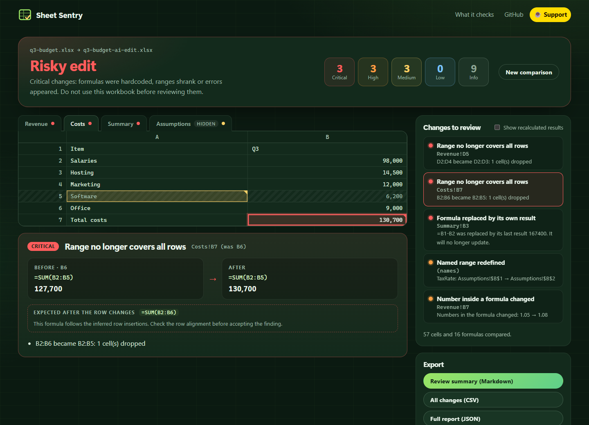
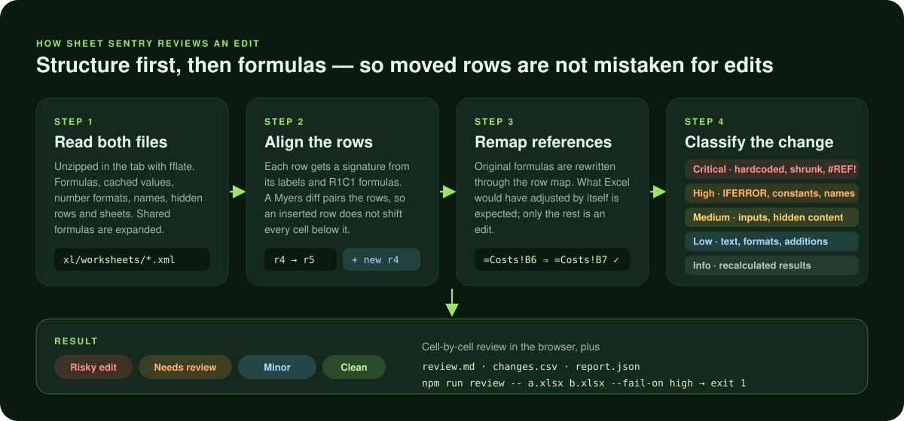
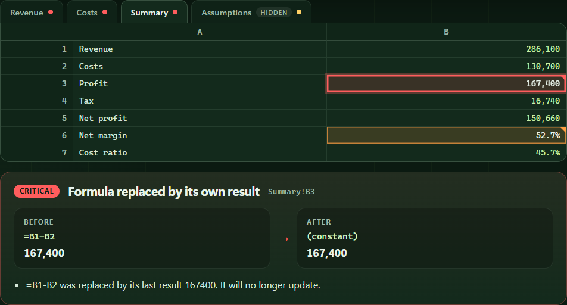
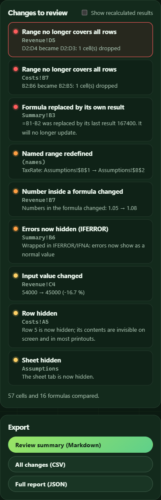
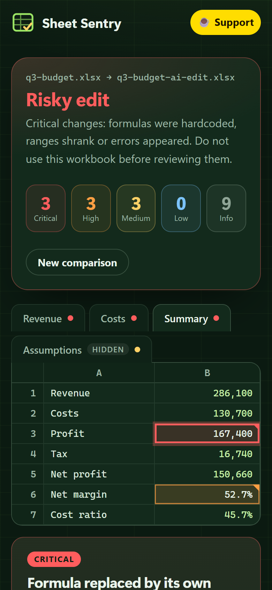

<p align="center">
  
</p>

<h3 align="center">An AI “tidied up” your spreadsheet. Did it hardcode a total, shrink a SUM or hide an error? Find out before anyone uses the numbers.</h3>

<p align="center">
  <a href="#quick-start"><b>Quick start</b></a> ·
  <a href="#what-it-catches">What it catches</a> ·
  <a href="#how-it-works">How it works</a> ·
  <a href="#a-tour-of-the-app">Tour</a> ·
  <a href="#command-line-and-ci">CLI &amp; CI</a> ·
  <a href="#faq">FAQ</a> ·
  <a href="https://buymeacoffee.com/ufodia">Support ☕</a>
</p>

<p align="center">
  
  
  
  
  
</p>

---

## The problem

Copilots and agents now edit real financial models: *“add a marketing line”*, *“clean up this sheet”*, *“fix the errors”*. They work fast and the result looks right. But spreadsheets fail silently, and the failures AI edits tend to produce are exactly the ones nobody sees:

- a formula pasted over with **its own last result** — correct today, frozen forever;
- a new row inserted **just outside** a `SUM` range, so the total quietly ignores it;
- `#DIV/0!` “fixed” by wrapping the formula in **`IFERROR(…, 0)`**;
- a growth rate of `1.05` that became **`1.08`** inside a formula;
- a named range pointed at **the wrong cell**, a row or a whole sheet **hidden**.

Excel shows you the new numbers. It does not show you what changed underneath them.

## The answer

**Sheet Sentry** compares the original workbook with the AI-edited one — in your browser — cell by cell and formula by formula. Row alignment helps separate inferred insertions from formula edits, and findings are ranked from **critical** to **info** so you review the strongest signals first. It works with files edited by Copilot, ChatGPT, Claude, Gemini, a script or a colleague; no model integration is required.

<p align="center">
  
  <br><sub>The synthetic demo. A Marketing row was inserted, but the total still sums the old rows. Sheet Sentry places the inferred insertion-adjusted formula (<code>=SUM(B2:B6)</code>) beside the edited formula. Check the alignment before accepting a finding.</sub>
</p>

## Who it is for

| You… | Sheet Sentry helps you… |
| --- | --- |
| **let Copilot, ChatGPT, Claude or an agent edit spreadsheets** | accept the useful edits and catch the silent damage before you send the file on |
| **own a financial model, budget or forecast** | review a colleague's or a tool's changes in minutes instead of re-auditing every formula |
| **work in FP&A, audit or controlling** | keep a written record (Markdown, CSV, JSON) of what changed between two versions |
| **build AI spreadsheet features or agents** | regression-test your agent: fail CI when an edit introduces critical changes |
| **teach spreadsheet risk** | show, on a real file, why “the numbers look fine” is not a review |

## Quick start

> **Requirements:** Node.js 24 and npm. No account, no API key, no Excel installation.

```bash
git clone https://github.com/ufodia/sheet-sentry.git
cd sheet-sentry
npm ci
npm run dev
```

Open the printed `http://127.0.0.1:5173` address. Drop the **original workbook** into slot 1 and the **AI-edited workbook** into slot 2 — or click **Review the demo budget**. Click **Download the demo files** to get both demo `.xlsx` files and open them in Excel yourself.

Prefer the terminal?

```bash
npm run review -- examples/q3-budget.xlsx examples/q3-budget-ai-edit.xlsx
```

## What it catches

| Severity | Change | Example |
| --- | --- | --- |
| 🟥 **Critical** | **Formula replaced by its own result** | `=B1-B2` became the constant `167400` — right today, never updates again |
| 🟥 **Critical** | **Formula replaced by a constant** | a formula became a different typed number |
| 🟥 **Critical** | **Range no longer covers all rows** | `SUM(B2:B6)` (after the row insert) is `SUM(B2:B5)` |
| 🟥 **Critical** | **Error introduced** | a cell now shows `#REF!`, `#DIV/0!` or `#N/A`, or a formula lost a reference |
| 🟧 **High** | **Errors now hidden** | `=B5/B1` became `=IFERROR(B5/B1,0)` |
| 🟧 **High** | **Number inside a formula changed** | `=E5*1.05` became `=E5*1.08` |
| 🟧 **High** | **Formula points somewhere else** | references moved to another range or sheet |
| 🟧 **High** | **Formula breaks its pattern** | one cell in a row or column of identical formulas is different |
| 🟧 **High** | **Named range redefined · sheet removed · macros or external links added** | `TaxRate` now points at `Assumptions!$B$2` |
| 🟨 **Medium** | **Input value changed · formula edited · range grew** | `54000` became `45000` (−16.7 %) |
| 🟨 **Medium** | **Row hidden · sheet hidden · rows deleted · cell cleared · name removed** | content made invisible on screen and in most printouts |
| 🟦 **Low** | **Text, number format, new cells, new or unhidden sheets, new names** | presentation and additions |
| ⬜ **Info** | **Result recalculated · rows inserted** | an output moved only because its inputs did — listed, not alarmed |

The verdict follows the most severe change: **Risky edit** (any critical), **Needs review** (any high), **Minor changes**, or **No meaningful changes**.

## How it works

<p align="center">
  
</p>

1. **Read both files.** Each `.xlsx`/`.xlsm` is unzipped in the tab with [fflate](https://github.com/101arrowz/fflate) and its SpreadsheetML read directly: formulas, cached values, number formats, defined names, hidden rows and sheets, macros and external links. Shared formulas are expanded to every cell they cover.
2. **Align the rows.** Every row gets a signature made of its labels and its formulas in position-independent R1C1 form. A Myers diff pairs rows between the two versions, so an inserted row does not make every cell below it look changed.
3. **Remap supported references.** Original A1 references follow the inferred row insertions, including cross-sheet references. Row deletions receive conservative review findings because deleting a cell and shrinking a range have different semantics. This is a heuristic reconstruction, not Excel's calculation engine.
4. **Classify.** Differences are analysed for hardcoding, new errors, `IFERROR`/`IFNA` wrappers, changed constants, shrunken or grown ranges, moved references and broken formula patterns, then ranked.

Read the full [method](docs/method.md), including what it cannot tell you.

## A tour of the app

<table>
  <tr>
    <td width="62%"></td>
    <td width="38%"></td>
  </tr>
  <tr>
    <td><b>Sheet view and inspector.</b> Changed cells are outlined by severity on the edited sheet. Select one to see the formula and value before and after, plus the formula inferred from supported row insertions.</td>
    <td><b>Changes to review.</b> Most severe first. Click one to jump to its sheet and cell; filter by severity with the counters.</td>
  </tr>
  <tr>
    <td></td>
    <td align="center"></td>
  </tr>
  <tr>
    <td><b>Start.</b> Two slots, a demo, and what each severity means.</td>
    <td><b>Phone-ready.</b> Review an attachment on the go.</td>
  </tr>
</table>

## Command line and CI

The same engine runs in Node. It prints a Markdown review and exits non-zero when a change reaches the threshold you choose.

```bash
npm run review -- original.xlsx edited.xlsx [--json report.json] [--csv changes.csv] [--fail-on critical|high|medium|low|info]
```

| Exit code | Meaning |
| --- | --- |
| `0` | nothing at or above `--fail-on` (default: `critical`) |
| `1` | at least one change at or above `--fail-on` |
| `2` | usage, workbook or report-output error |

Report paths must differ from both inputs and from one another. Existing input aliases, including symbolic links and hard links, are checked before writing. `--help` prints usage and exits `0`. Review reports can contain sensitive workbook content; protect them accordingly.

<details>
<summary><b>Example: the review printed for the demo</b></summary>

```markdown
# Sheet Sentry review

**q3-budget.xlsx** → **q3-budget-ai-edit.xlsx** · 2026-11-14

**Verdict:** Risky — critical changes need review before this workbook is used

| Critical | High | Medium | Low | Info |
| ---: | ---: | ---: | ---: | ---: |
| 3 | 3 | 3 | 0 | 9 |

57 cells and 16 formulas compared.

## Changes to review

| Severity | Where | What | Detail |
| --- | --- | --- | --- |
| critical | Revenue!D5 | Range no longer covers all rows | D2:D4 became D2:D3: 1 cell(s) dropped |
| critical | Costs!B7 | Range no longer covers all rows | B2:B6 became B2:B5: 1 cell(s) dropped |
| critical | Summary!B3 | Formula replaced by its own result | =B1-B2 was replaced by its last result 167400. It will no longer update. |
| high | (names) | Named range redefined | TaxRate: Assumptions!$B$1 → Assumptions!$B$2 |
| high | Revenue!B7 | Number inside a formula changed | Numbers in the formula changed: 1.05 → 1.08 |
| high | Summary!B6 | Errors now hidden (IFERROR) | Wrapped in IFERROR/IFNA: errors now show as a normal value |
| medium | Revenue!C4 | Input value changed | 54000 → 45000 (-16.7 %) |
| medium | Costs!A5 | Row hidden | Row 5 is now hidden; its contents are invisible on screen and in most printouts. |
| medium | Assumptions | Sheet hidden | The sheet tab is now hidden. |
```

</details>

<details>
<summary><b>Example: block an AI agent's edit in GitHub Actions</b></summary>

```yaml
- uses: actions/checkout@v5
  with:
    fetch-depth: 2
- uses: actions/checkout@v5
  with:
    repository: ufodia/sheet-sentry
    path: .sheet-sentry
- uses: actions/setup-node@v5
  with:
    node-version: 24
- run: npm ci --prefix .sheet-sentry
- name: Review the agent's workbook edit
  run: |
    git show HEAD~1:models/budget.xlsx > /tmp/before.xlsx
    npm run --prefix .sheet-sentry review -- /tmp/before.xlsx "$PWD/models/budget.xlsx" \
      --fail-on high --csv "$PWD/sheet-sentry-changes.csv" >> "$GITHUB_STEP_SUMMARY"
```

The review lands in the job summary, and the step fails when the edit contains a high or critical change.

</details>

## Exports

| File | Contents |
| --- | --- |
| `sheet-sentry-review.md` | verdict, counts and every change above info — ready for a pull request, ticket or email |
| `sheet-sentry-changes.csv` | every change including recalculated results: severity, kind, sheet, cell, original cell, before, after, detail |
| `sheet-sentry-report.json` | the full comparison: tool version, files, verdict, counts, per-sheet inserted/deleted rows, and each change with before/after state and the expected formula |

Formula-like CSV fields are prefixed with `'`, including fields with leading whitespace or control characters; embedded carriage returns and newlines are quoted. This reduces spreadsheet formula-injection risk. Import reports as text and review spreadsheet application prompts before enabling active content. Markdown escapes workbook markup; JSON preserves source text as data.

## Privacy

Workbooks are unzipped and compared in your browser tab. No upload endpoint, model API, account or API key is involved. The production configuration sends `Content-Security-Policy: connect-src 'none'` to block scripted data connections. The app has no persistent storage, analytics, external fonts or runtime CDNs. Loading the page contacts its host; following GitHub or support links contacts those destinations. Macros are detected, never run. See [docs/privacy.md](docs/privacy.md).

## Honest limitations

- **No recalculation.** Sheet Sentry reads the values Excel cached when the file was saved. Files written by tools that do not store calculated values show formulas but no results.
- **Rows, not columns.** Inserted and deleted **rows** are aligned. Inserted **columns** are compared by position and show up as many changes.
- **Alignment is inferred.** Repeated or heavily edited rows can pair ambiguously. The bounded Myers search falls back to positional anchors after 1,500 edit steps. Check the before/after addresses; deletion-affected references require manual review.
- **Formula coverage is partial.** Standard A1 references and shared formulas are supported. Structured table labels and external workbook references are left intact; 3D references, dynamic arrays, data tables and unusual SpreadsheetML serializations need manual verification. No semantic equivalence proof is attempted.
- **Renamed sheets** appear as one sheet removed and one added.
- **Not compared:** charts, pivot tables, conditional formatting, data validation, comments and the contents of VBA code (only the presence of macros is reported).
- **Display is simplified.** Common number and percentage formats are shown; date serials remain numeric. Cached values may be stale. Numeric changes within a relative tolerance of `1e-9` are treated as equivalent.
- **Formats:** `.xlsx` and `.xlsm`. Legacy `.xls`, binary `.xlsb`, `.ods` and password-protected workbooks are not supported — save an unprotected copy as `.xlsx`.
- **Size:** at most 50 MB per file, 300 MB of selected uncompressed XML, 3 million populated cells and 1.5 million combined worksheet row positions per workbook. Processing is synchronous; large files can pause the tab. The sheet view shows the first 40 columns; every populated column is compared. The findings list shows up to 400 matching entries; exports contain the complete report.
- **Input checks are conservative.** Missing worksheet parts, unresolved shared formulas, invalid values or addresses, unsupported empty formulas and XML entity declarations are rejected with an explanation instead of producing a reassuring partial comparison.

## FAQ

<details>
<summary><b>Does it work with edits from Microsoft Copilot, ChatGPT, Claude or Gemini?</b></summary>

Yes. It compares any two versions of a workbook, whoever or whatever made the second one. It is equally useful for edits made by a colleague, a macro or a script.
</details>

<details>
<summary><b>Is my workbook uploaded anywhere?</b></summary>

No. The comparison runs in your browser tab; the production policy blocks scripted connections. Opening the site loads its own assets, and external links open the service you choose. The command line reads files from disk and writes only the reports you ask for.
</details>

<details>
<summary><b>What about Google Sheets?</b></summary>

Download both versions with **File → Download → Microsoft Excel (.xlsx)**. For an earlier version, open it from **File → Version history**, make a copy, and download that copy.
</details>

<details>
<summary><b>Why is a changed total only “info”?</b></summary>

An unchanged or insertion-remapped formula with a different cached result is listed as info (turn on **Show recalculated results**). Sheet Sentry does not recalculate or establish why the value changed. Review its inputs and the saved workbook before trusting the result.
</details>

<details>
<summary><b>Does a “clean” verdict mean the model is correct?</b></summary>

No. It means the edit did not change formulas, inputs or structure in a way Sheet Sentry recognises as risky. It is a review aid, not an audit opinion.
</details>

## Documentation

| Guide | What's inside |
| --- | --- |
| [User guide](docs/user-guide.md) | loading files, reading the verdict, the sheet view, filters, exports and troubleshooting |
| [Method](docs/method.md) | parsing, row alignment, reference remapping, each change kind, severities and limitations |
| [Architecture](docs/architecture.md) | modules, data model, CLI and report formats |
| [Privacy](docs/privacy.md) · [Deployment](docs/deployment.md) | what runs where, and self-hosting with security headers |
| [Changelog](CHANGELOG.md) | release notes |

## Development

```bash
npm run dev            # local development server
npm run check          # strict typecheck, unit/CLI tests and a production build
npm run test:browser   # Playwright tests in Chromium; local port 4175
npm run review -- a.xlsx b.xlsx   # command-line review
npm run demo-files     # rewrite examples/*.xlsx from src/demo.ts
npm run format:check   # Prettier
npm run screenshots    # regenerate README screenshots from the demo
```

The engine is plain TypeScript with one dependency (fflate, for unzipping). The suite includes 64 unit/CLI tests and 11 browser scenarios covering the synthetic demo, malformed inputs, sparse sheets, formula handling, report escaping, input overwrite protection, upload races, downloads and responsive layout. Fixtures include hand-written SpreadsheetML as well as the minimal demo writer; they are not an Excel conformance certification. See [CONTRIBUTING.md](CONTRIBUTING.md).

To restore on a replacement computer, clone the repository, install Node.js 24, run `npm ci`, then `npm run check`. Install the Chromium test browser with `npx playwright install chromium` before running the browser suite. Build output and dependencies are regenerated; no secret environment variables are required for local use.

## Maintainer

Created and maintained by **[ufodia](https://github.com/ufodia)**, currently the sole contributor. Source, documentation, demo workbooks and original illustrations are available under MIT; dependency attribution is preserved in [THIRD_PARTY_NOTICES.md](THIRD_PARTY_NOTICES.md).

## Support

Sheet Sentry is free and has no ads. If it caught a hardcoded total before it reached a board deck, a coffee keeps it maintained.

<p align="center">
  <a href="https://buymeacoffee.com/ufodia"></a>
</p>

## License

[MIT](LICENSE) © 2026 [ufodia](https://github.com/ufodia). Not affiliated with Microsoft; Excel is a trademark of Microsoft Corporation.
